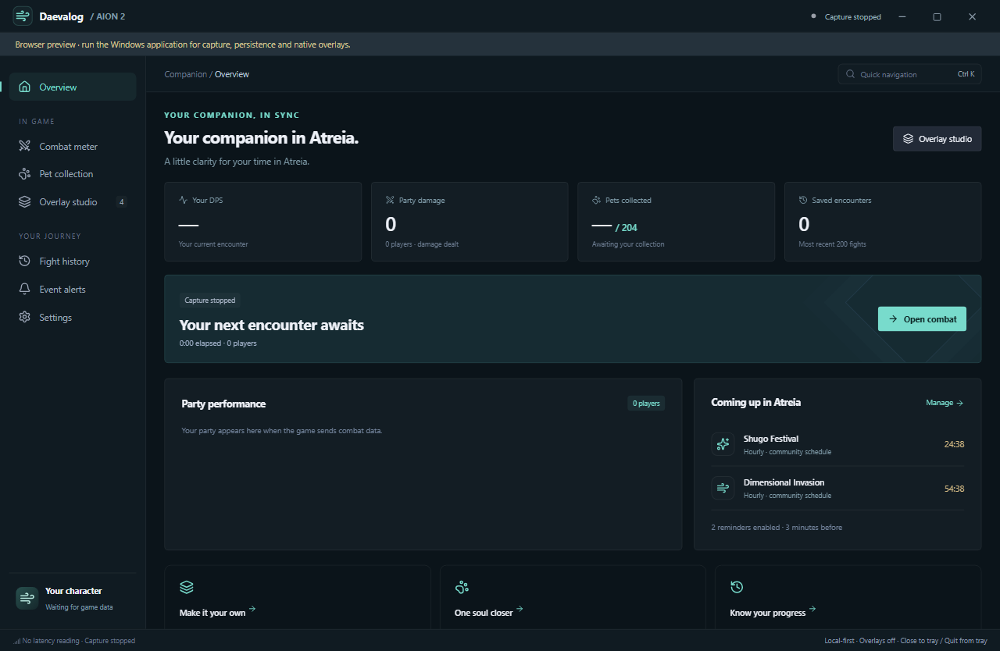
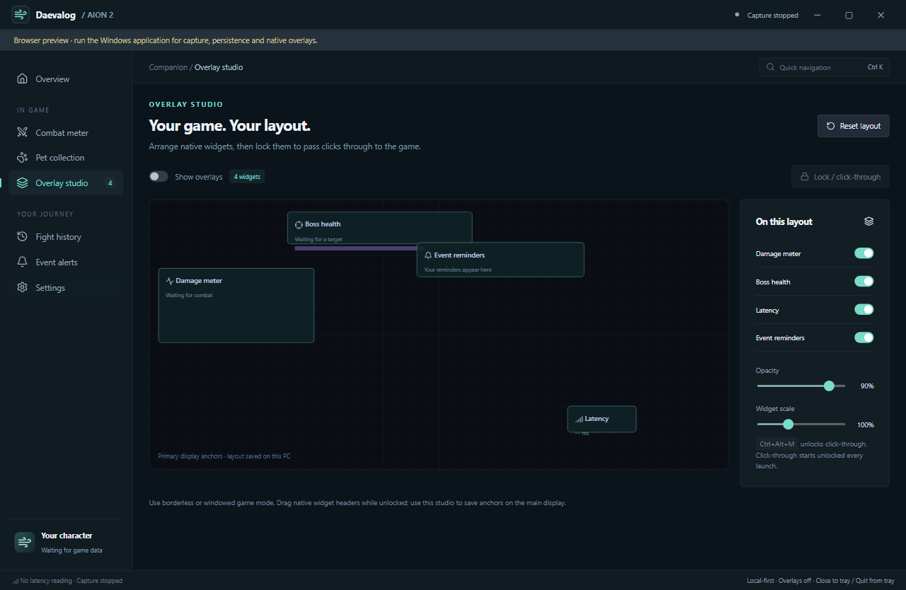
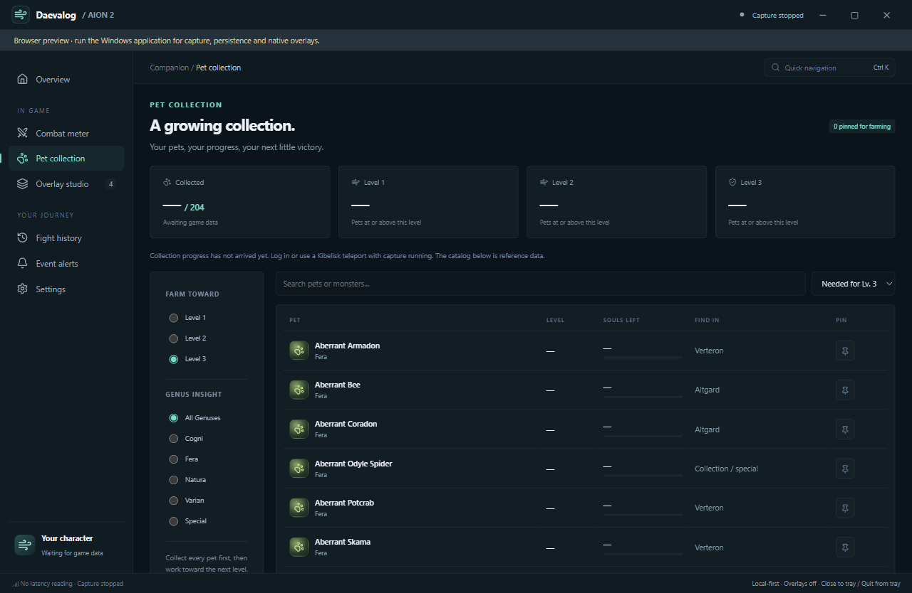

# Selected Windows companion validation

Recorded 2026-10-19 for the C-visuals / A-content implementation in PR #1.
The native application embeds React assets in Tauri/WebView2, supervises one
Rust capture daemon and sends coalesced snapshots to one native egui overlay host.

## Application views

These are the implemented React views in browser preview, showing disconnected
states and the real pet catalog. Capture and window integration run in the
native Windows application, tested below.







## Automated checks

- Windows: 28 daemon tests and 7 desktop tests pass. The latter include typed
  command rejection, preferences bounds, non-persisted click-through, saved
  skill calculations, and stale-state invalidation after capture exits.
- Frontend: TypeScript/Vite production build and 4 domain presentation tests pass.
- Linux/WSL: 27 daemon/tray tests and the existing daemon replay regression pass.
  The four existing overlay JavaScript checks pass with the Windows working
  copy's CRLF normalized to LF in memory, matching the source checkout on Linux.
- Clippy checks repository crates with `--no-deps`, as CI does. The upstream
  A2Tools submodule has pre-existing Clippy warnings; it is not reformatted or changed.
- Real WebView2 release smoke passes all 13 checks: React/theme, command palette, daemon replay
  damage (27,200), captured pets, four native HWNDs, unlocked startup,
  WS_EX_TRANSPARENT lock/unlock styles, reminder, saved fixture listing,
  history detail, and capture/overlay shutdown plus persisted preferences.
  History detail uses a labeled persisted fixture because the network fixture
  contains ordinary NPC damage rather than a boss encounter.
- Browser layout QA visited all seven React pages at 1320x860 and the native
  minimum 860x600, with no page-level horizontal overflow. Browser preview uses
  disconnected states and the real reference catalog; native integration is
  verified separately by the WebView2 smoke test.

Reproduce native integration and the short idle sample with:

```powershell
./scripts/test-companion.ps1 -Release -MeasureIdle
```

The test creates isolated storage below `target/companion-smoke-<id>` and writes
`report.json` and `performance.json`. Its report command and alternate QA hotkey
are opt-in build features excluded from normal packages.

## Short release idle sample

Machine: Windows 11 Pro (10.0.26200), AMD Ryzen 7 7800X3D, 16 logical processors.
Condition: companion open, four native widgets, capture stopped, system sound
off. This includes the app, overlay host and WebView2 descendants (8 processes).

| Measurement | Observed |
| --- | ---: |
| Sample length | 5.10 seconds |
| Combined private committed memory | 274.9 MiB |
| CPU, one logical core equivalent | 8.26% |
| CPU, normalized to total machine capacity | 0.52% |

This is a short development-PC sample after startup, not a comparative framework
benchmark, a 60-second acceptance test, or a game-FPS result. Private committed
memory is not private working set. The [stack budgets](windows-ui-stack.md)
still require weakest-PC, mixed-DPI, extended replay and live-game testing.
Window style checks do not prove mouse delivery into AION 2. Exclusive fullscreen,
arbitrary monitor selection and persisted native free-drag placement are not validated.

## Review follow-through

### Standards

No documented-standard violations were found. Correctness findings: stale
capture state after daemon exit, inaccurate history identity fallback, and
settings drafts retaining startup defaults. All were corrected. The judgment
that queued preference writes could grow without a bound was addressed with
one active write plus one replaceable pending value.

### Spec

The selected hierarchy and visual theme were consistent. Findings: stale native
combat after capture exit, misleading “Your DPS” history fallback, and a smoke
claim broader than its window-style assertion. The state is now cleared, history
shows “Top DPS,” and validation explicitly limits its claim to native styles.

Findings by axis: Standards 3 correctness issues and 1 transport judgment;
Spec 3 correctness/validation issues. These are addressed; in-game verification
remains an explicit validation limit.
