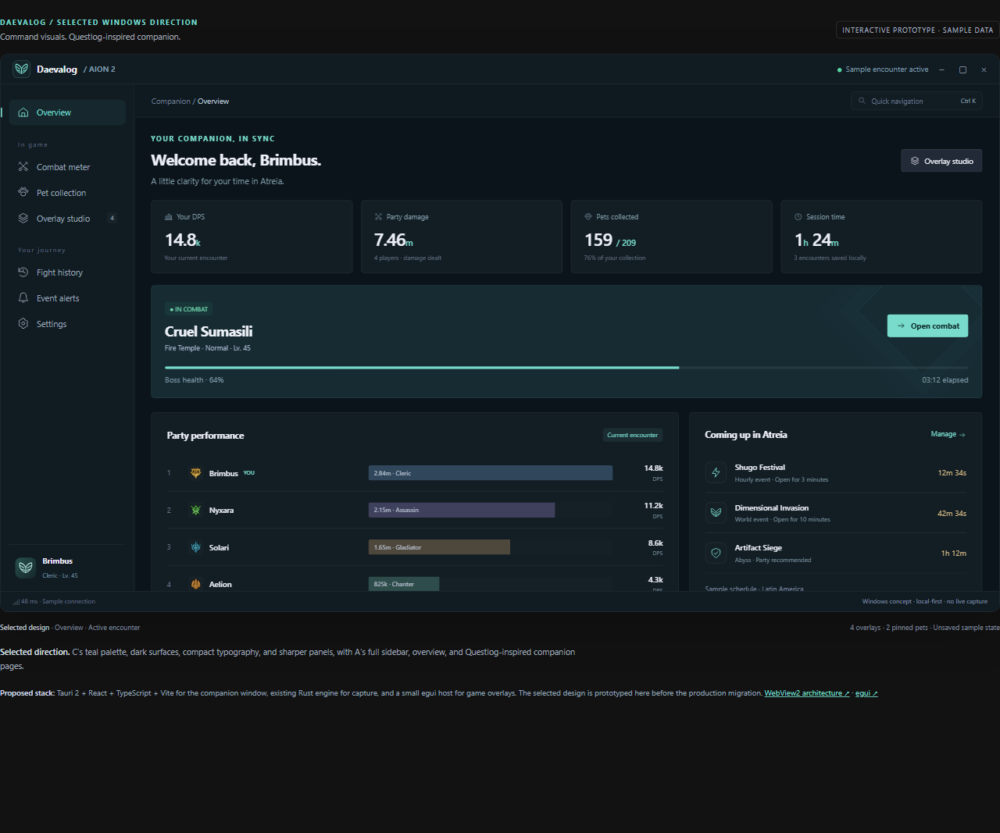
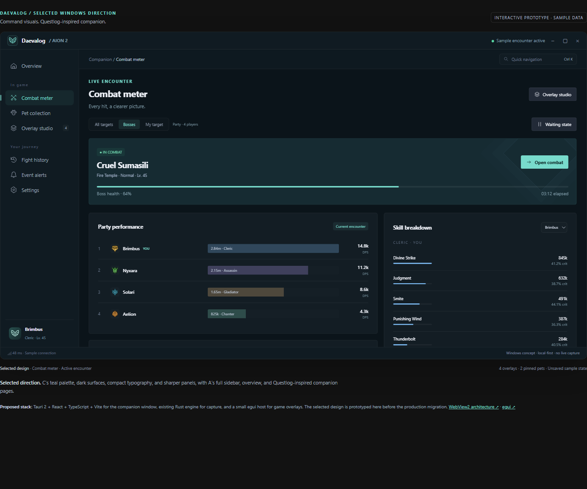

# Selected Windows companion design

**Decision: C's visuals with A's Questlog-like content and navigation.**

The selected preview combines Command's dark teal surfaces, mint accents,
compact typography, subtle borders and sharper panels with Obsidian's full
labeled sidebar, overview-first entry point and companion pages. The design
chooser and unused alternatives have been removed.

Run from the repository root with Node.js 18 or newer:

~~~sh
node scripts/preview-desktop.mjs
~~~

Open <http://localhost:4173/>. No install or build step is required. The server
binds only to loopback. Set `DAEVALOG_PREVIEW_PORT` to use another port.
Opening `index.html` directly works offline with vector class placeholders.

The full sidebar, overview, encounter summary, party performance, upcoming
events, and quick actions follow A. C supplies the visual treatment throughout
combat, pets, the overlay editor, history, alerts, and preferences.

`Ctrl+K` opens page search. URLs preserve the page and encounter state, for
example `?page=combat&state=waiting`. Earlier `?variant=A|B|C` links now resolve
to the selected design.

## Explore

- Combat: switch between active and waiting states; select a player's skills.
- Pets: search, filter by genus and pin pets. Phase controls preview the target
  selection; rows remain fixed samples.
- Overlays: drag widgets, or focus one and use arrow keys; toggle visibility,
  grid snapping, scale and opacity, then reset.
- History: select a run to open the shared sample combat view.
- Alerts: toggle reminders and send a test banner.

This remains an isolated HTML prototype with fictional in-memory data. It is
outside Cargo and release packaging. Capture, native windows, real timers,
sound and storage will be connected during production implementation.

The app viewport scrolls internally; narrow previews collapse the sidebar and
secondary dashboard panels. A full desktop browser shows the intended labeled
navigation. Class portraits are existing repository assets embedded by the
server. No CDN, external font, or Questlog artwork is required.

## Design record

The original three-way exploration is preserved at
[`67b84af`](https://github.com/ph-cardoso/aion2dpsmeter/tree/67b84af8ecbc02cb476c990a6fce96dfceb0cd13/windows/prototype).
That commit is the reference for the user's selection; the current preview is
the chosen composition.

Read [the selected design contract](../../docs/windows-ui-design.md) and
[technology evaluation](../../docs/windows-ui-stack.md) for implementation
boundaries and proposed performance budgets.
