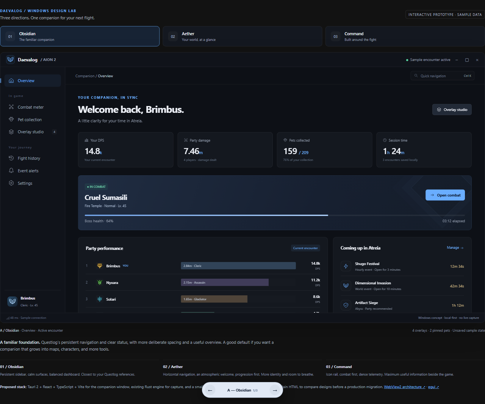
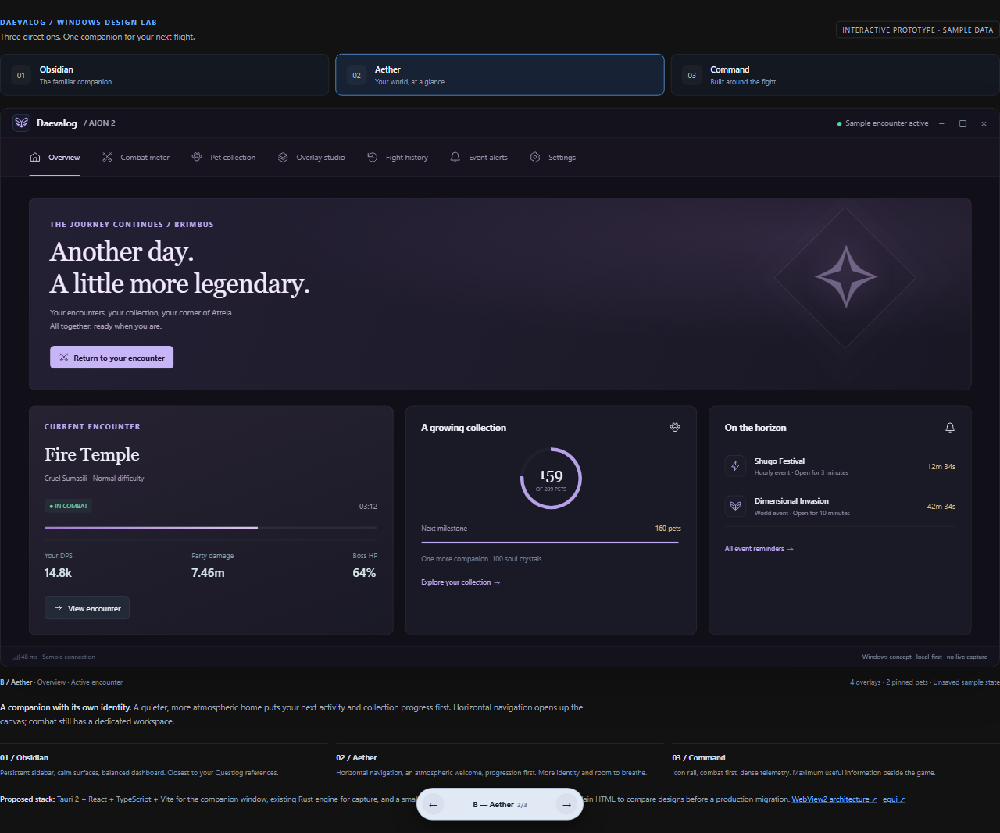
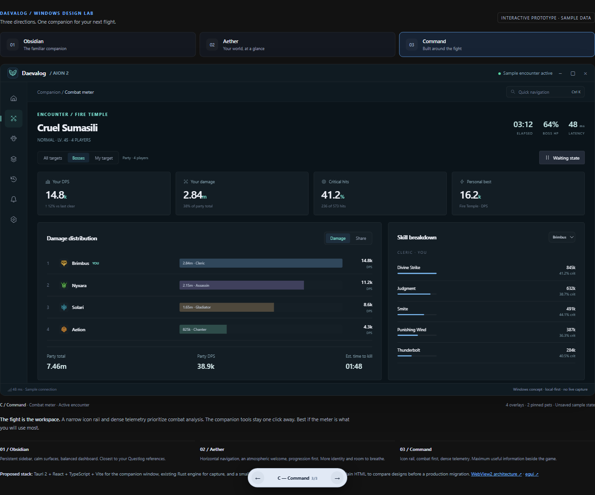

# Windows desktop design lab

Three **throwaway UI directions**, informed by the supplied Questlog desktop
screenshots. The question is which navigation, information hierarchy and visual
identity should guide Daevalog's Windows companion.

Run from the repository root with Node.js 18 or newer:

~~~sh
node scripts/preview-desktop.mjs
~~~

Open <http://localhost:4173/>. No install or build step is required. The server
binds only to loopback. Set `DAEVALOG_PREVIEW_PORT` to use another port.
You can also open `index.html` directly; class portraits become vector placeholders.

| Direction | Direct URL | Structure |
| --- | --- | --- |
| A — Obsidian | <http://localhost:4173/?variant=A> | Persistent sidebar, balanced overview, restrained blue surfaces; closest to Questlog. |
| B — Aether | <http://localhost:4173/?variant=B> | Horizontal navigation, atmospheric welcome, collection and activity first. |
| C — Command | <http://localhost:4173/?variant=C> | Narrow icon rail, combat-first workspace, dense telemetry and an inspector. |

### A — Obsidian

### B — Aether

### C — Command

Use the top buttons or floating arrows to switch. Left/right arrow keys cycle
directions unless an input, select, dialog or movable widget has focus.
`Ctrl+K` opens page search. URLs preserve the direction, page and encounter state,
for example `?variant=C&page=combat&state=waiting`.

## Explore

All three include overview, combat, pet collection, overlay studio, history,
alerts and preferences. Try:

- Combat: switch between the active and waiting states; select a player's skills.
- Pets: search, filter by genus and pin pets. Phase controls preview the target
  selection; the small set of rows remains a fixed sample rather than computing
  real farming projections.
- Overlays: drag widgets, or focus one and use arrow keys; toggle visibility,
  grid snapping, scale and opacity, then reset the layout.
- History: select a row to open the shared sample combat view.
- Alerts: toggle reminders and send a test banner.

This is an HTML design prototype, **not the Windows executable**. Data is
fictional and lives only in memory. Window controls are decorative. Network
capture, real timers, native notifications/sound, always-on-top, click-through,
file storage and native overlay windows are not connected. The code is outside
the packaged app and is not referenced by Cargo or release packaging.

The app-like viewport scrolls internally; narrow previews collapse the navigation
and some secondary dashboard panels. A full desktop browser is the best place
to judge desktop density. Existing class icons are embedded by the server;
no third-party runtime, CDN, font download or Questlog image is required.

## Technology and next decision

Read [the technology evaluation](../../docs/windows-ui-stack.md) for the comparison,
proposed performance budgets and migration boundary. The recommendation is
Tauri 2 + React + TypeScript + Vite for the rich companion, the current Rust
daemon for capture, and a small egui host for game overlays.

Choose a direction or combine specific details. Then implement a real native
slice and measure it before replacing the working frontend. The prototype is
kept on PR #1's feature branch for review; remove the switcher and losing designs
from the eventual production change once a direction is selected.
